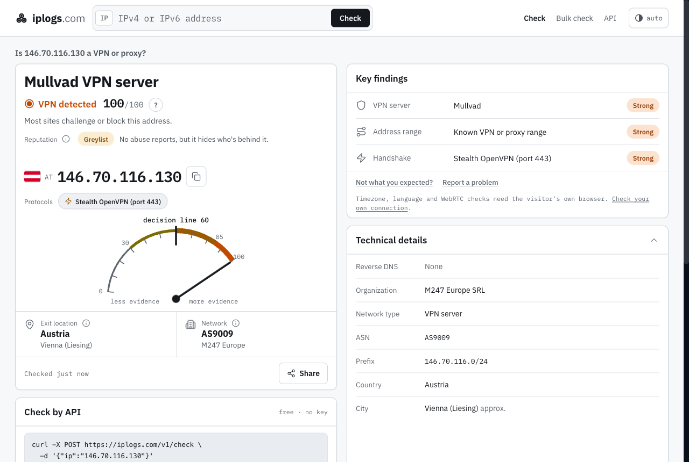
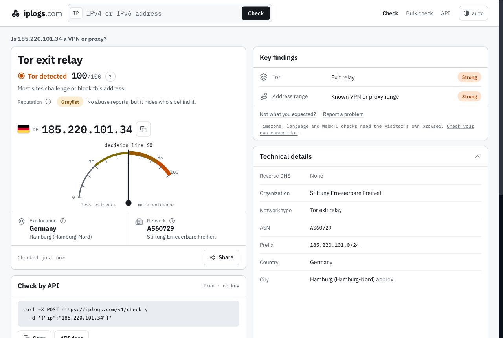
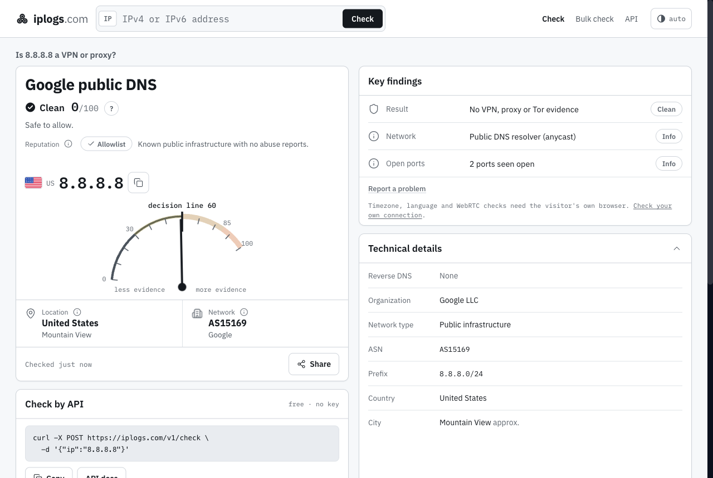
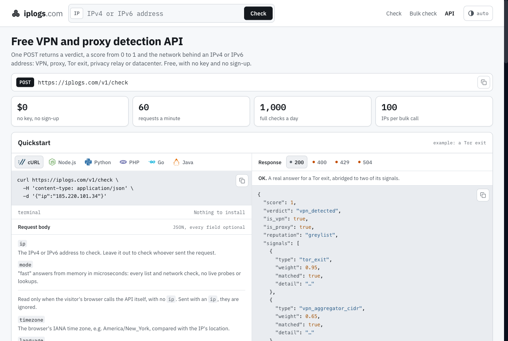

# iplogs.com API

**Is this IP a VPN, proxy or Tor exit? One POST answers it. Free, no API key, no sign-up.**

```bash
curl https://iplogs.com/v1/check \
  -H 'content-type: application/json' \
  -d '{"ip":"185.220.101.34"}'
```

```json
{
  "score": 1,
  "verdict": "vpn_detected",
  "is_vpn": true,
  "is_proxy": true,
  "reputation": "greylist",
  "signals": [
    { "type": "tor_exit", "weight": 0.95, "matched": true,
      "detail": "Published Tor exit relay (current Tor exit list)" },
    { "type": "vpn_aggregator_cidr", "weight": 0.65, "matched": true,
      "detail": "Listed in a VPN range list" }
  ],
  "ip_info": {
    "ip": "185.220.101.34", "asn": "AS60729",
    "org": "Stiftung Erneuerbare Freiheit",
    "country": "Germany", "country_code": "DE",
    "vpn_provider": "Tor"
  },
  "request_id": "req_6228befb-59f"
}
```

A real answer, abridged. IPv4 and IPv6 both work.

| Free tier | |
|---|---|
| Requests | 60 a minute per IP (IPv6 counted per /64) |
| Full checks | 1,000 a UTC day, then answers come from the fast path (still `200`) |
| Bulk | 100 IPs per call |
| Key / sign-up | None |

[Check an IP](https://iplogs.com/ip) · [API docs](https://iplogs.com/docs) · [Bulk check](https://iplogs.com/bulk) · [Datasets](https://iplogs.com/tools) · [Accuracy](https://iplogs.com/accuracy)

---

## What it looks like

Every address has a page at `iplogs.com/ip/<address>` with the same answer the API gives.

| A VPN server | A Tor exit | Public DNS |
|---|---|---|
|  |  |  |

Open [iplogs.com](https://iplogs.com) to check your own connection. It also runs the browser-only tests: WebRTC leak, time zone and language.

---

## The answer

| `verdict` | `score` | Suggested action |
|---|---|---|
| `clean` | below 0.30 | Allow. |
| `suspicious` | 0.30 to 0.59 | Allow; add friction only on sensitive actions. |
| `vpn_likely` | 0.60 to 0.84 | Challenge: verify an email or phone, or require a login. |
| `vpn_detected` | 0.85 and up | Challenge or block, per your policy on VPNs and Tor. |

- `is_vpn` is true from 0.60. `is_proxy` is the same test counting only proxy-type evidence.
- `reputation` is separate from the verdict: `allowlist`, `greylist` (hidden or hosted, no abuse) or `blocklist` (recent attacks or abuse).
- `signals` lists every check that ran, with its weight. Only matched signals add to the score, so you can see why an address scored what it did.
- `ip_info.vpn_provider` names the operator when one is known (Mullvad, Tor, Apple Private Relay). A missing name is not a clean result: many detections come from ranges with no operator named. Decide on `verdict` or `is_vpn`.

---

## Quickstart

Each one is a complete program, run against the live API before it was published here. All print `vpn_detected 1`.

<details>
<summary><b>Node.js</b> (Node 18+, no packages)</summary>

```js
const res = await fetch("https://iplogs.com/v1/check", {
  method: "POST",
  headers: { "content-type": "application/json" },
  body: JSON.stringify({ ip: "185.220.101.34" }),
  signal: AbortSignal.timeout(30_000),
});
if (!res.ok) throw new Error(`iplogs.com answered ${res.status}`);
const { verdict, score } = await res.json();
console.log(verdict, score); // vpn_detected 1
```
</details>

<details>
<summary><b>Python</b> (pip install requests)</summary>

```python
import requests

r = requests.post(
    "https://iplogs.com/v1/check",
    json={"ip": "185.220.101.34"},
    timeout=30,
)
r.raise_for_status()
data = r.json()
print(data["verdict"], data["score"])  # vpn_detected 1
```
</details>

<details>
<summary><b>PHP</b> (PHP 8 with the curl extension)</summary>

```php
<?php
$ch = curl_init("https://iplogs.com/v1/check");
curl_setopt_array($ch, [
    CURLOPT_POST => true,
    CURLOPT_HTTPHEADER => ["Content-Type: application/json"],
    CURLOPT_POSTFIELDS => json_encode(["ip" => "185.220.101.34"]),
    CURLOPT_RETURNTRANSFER => true,
    CURLOPT_TIMEOUT => 30,
]);
$data = json_decode(curl_exec($ch), true);
echo $data["verdict"], " ", $data["score"], "\n"; // vpn_detected 1
```
</details>

<details>
<summary><b>Go</b> (standard library only)</summary>

```go
package main

import (
	"encoding/json"
	"fmt"
	"net/http"
	"strings"
	"time"
)

func main() {
	client := &http.Client{Timeout: 30 * time.Second}
	resp, err := client.Post("https://iplogs.com/v1/check", "application/json",
		strings.NewReader(`{"ip":"185.220.101.34"}`))
	if err != nil {
		panic(err)
	}
	defer resp.Body.Close()

	var r struct {
		Verdict string  `json:"verdict"`
		Score   float64 `json:"score"`
	}
	if err := json.NewDecoder(resp.Body).Decode(&r); err != nil {
		panic(err)
	}
	fmt.Println(r.Verdict, r.Score) // vpn_detected 1
}
```
</details>

<details>
<summary><b>Java</b> (Java 11+, no dependencies)</summary>

```java
import java.net.URI;
import java.net.http.HttpClient;
import java.net.http.HttpRequest;
import java.net.http.HttpResponse;
import java.time.Duration;

public class Check {
    public static void main(String[] args) throws Exception {
        var req = HttpRequest.newBuilder(URI.create("https://iplogs.com/v1/check"))
            .header("Content-Type", "application/json")
            .timeout(Duration.ofSeconds(30))
            .POST(HttpRequest.BodyPublishers.ofString("{\"ip\":\"185.220.101.34\"}"))
            .build();
        var res = HttpClient.newHttpClient().send(req, HttpResponse.BodyHandlers.ofString());
        System.out.println(res.body()); // {"score":1,"verdict":"vpn_detected",...}
    }
}
```
</details>

Step-by-step guides: [Python](https://iplogs.com/guides/vpn-detection-python) · [Node.js](https://iplogs.com/guides/vpn-detection-nodejs) · [Go](https://iplogs.com/guides/vpn-detection-go) · [Detect VPN users on your website](https://iplogs.com/guides/detect-vpn-users) · [Block VPN traffic](https://iplogs.com/guides/block-vpn-traffic)

---

## Endpoints

| Method | Path | What it does |
|---|---|---|
| `POST` | `/v1/check` | One address in full: verdict, score, every signal and the network. |
| `POST` | `/v1/bulk-check` | Up to 100 addresses in one call. One compact row each, no live probes. |
| `GET` | `/v1/ip` | The caller's own address and its family. |
| `GET` | `/v1/health` | `{"status": "ok"}` while the API is up. |

### Request body (`/v1/check`)

| Field | Meaning |
|---|---|
| `ip` | The IPv4 or IPv6 address to check. Leave it out to check whoever sent the request. |
| `mode` | `"fast"` answers from memory in microseconds: every list and network check, no live probes or lookups. For logins and checkouts with a tight time budget. |

### Many addresses

```bash
curl https://iplogs.com/v1/bulk-check \
  -H 'content-type: application/json' \
  -d '{"ips":["185.220.101.34","146.70.116.130","8.8.8.8"]}'
```

Each row carries `ip`, `verdict`, `score`, `is_vpn`, `reputation`, `vpn_provider`, `country_code`, `asn` and `org`. A private address comes back as a row with `error` set; the rest still run. No code? Paste a list into [iplogs.com/bulk](https://iplogs.com/bulk).

### Errors and limits

| Status | When | What to do |
|---|---|---|
| `400` | Not an IP, or a private one (10.x, 192.168.x, loopback, link-local) | Send a public address. |
| `429` | Over 60 requests a minute, or the bulk burst (3 calls, then 1 every 5 s) | Wait `Retry-After` seconds, then retry. |
| `504` | A full check ran past 30 seconds | Retry, or send `"mode": "fast"`. |

Every charged response carries `X-RateLimit-Limit`, `X-RateLimit-Remaining` and `X-RateLimit-Reset`.

---

## Before you ship

- **Send the visitor's IP from your server.** Leave `ip` out and the API checks whoever made the request. Called from your backend, that is your own server.
- **Over the daily quota is still a `200`.** Past 1,000 full checks a day, answers come from the fast path with `"mode": "fast"`. No live probes run, so a server only a VPN handshake gives away can score lower.
- **Bulk rows skip live probes.** A bulk row can score lower than `/v1/check` for the same address. Re-check the borderline ones one at a time.
- **An answer can be 30 minutes old.** Full checks are cached per address for 30 minutes.
- **Give it 30 seconds, or ask for fast.** A first look at an unseen hosting address takes 5–7 s. With a hard budget, send `"mode": "fast"`.

---

## How it decides

Seven layers look at an address: IP intelligence, TCP/IP fingerprint, TLS fingerprint, round-trip timing, active probing, browser signals, and port and network sanity.

- **Strong evidence:** a server a VPN provider publishes, a Tor exit, a VPN or proxy range, an open proxy, an iCloud Private Relay or WARP exit, a live VPN handshake (OpenVPN, WireGuard, IKEv2, SOCKS5, HTTP CONNECT, REALITY).
- **Weaker evidence:** a datacenter or cloud network, unusual routing, a browser time zone or language that doesn't fit the IP.
- **Weak spot:** a residential proxy exit is close to undetectable from the IP alone.

Lists are refreshed from hourly to daily, and every check reads them from memory.



---

## Accuracy

Measured on 29 October 2026 against 1,064 known addresses: VPN servers, Tor exits, home connections, datacenters and CDNs.

| | |
|---|---|
| False positives | **0.6%** |
| False negatives | **0.5%** |
| Mullvad servers caught | **500 of 500** |
| Tor exits caught | **54 of 54** |

What each error was, and how the test set is built: [iplogs.com/accuracy](https://iplogs.com/accuracy).

| Path | Time |
|---|---|
| `"mode": "fast"`, any address | microseconds in the engine |
| Address checked in the last 30 minutes | under 1 ms |
| New address | about 1.9 s median |
| New hosting address | 5–7 s |

---

## Free datasets (CC-BY 4.0)

| File | What's in it |
|---|---|
| [`tor-exits.csv`](https://iplogs.com/data/tor-exits.csv) | Current Tor exit relays, IPv4 and IPv6 |
| [`vpn-providers.json`](https://iplogs.com/data/vpn-providers.json) | Every VPN server list the engine loads: counts, sample IPs, refresh times |
| [`mullvad-relays.csv`](https://iplogs.com/data/mullvad-relays.csv) | Every active Mullvad server |
| [`datacenter-asns.csv`](https://iplogs.com/data/datacenter-asns.csv) | Hosting and cloud networks by ASN |
| [`residential-proxy-backbones.csv`](https://iplogs.com/data/residential-proxy-backbones.csv) | Hosting networks (by ASN) known to carry residential-proxy infrastructure |
| [`cloudflare-ranges.txt`](https://iplogs.com/data/cloudflare-ranges.txt) | Cloudflare ranges, IPv4 and IPv6 |

Cloud ranges, ASN lists and the rest: [iplogs.com/tools](https://iplogs.com/tools).

---

## FAQ

**Why does my own IP say VPN when I'm not using one?** Shared mobile and carrier-grade NAT addresses, iCloud Private Relay and some ISPs' hosting ranges can look like one. [Why your IP is flagged](https://iplogs.com/guides/why-flagged-as-vpn) covers 12 causes and how to get it fixed.

**Is the score a probability?** No. It is the sum of the matched signals' weights, plus a small boost when independent signals agree, capped at 1.

**Can I self-host it?** No. The API and datasets are free to use; the detection engine is not public, because publishing every weight and probe would make it easy to evade.

**Higher limits?** Email [admin@iplogs.com](mailto:admin@iplogs.com) with your use case and volume.

---

## Report a wrong result

Email [admin@iplogs.com](mailto:admin@iplogs.com) with the IP and the `request_id`, or use "Report a problem" on the address's page. Issues on this repo are welcome too.

Built by [DigitalD.tech](https://digitald.tech). This README and the datasets are CC-BY 4.0.
